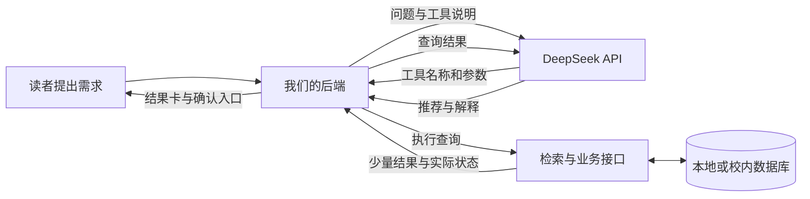

# Agent实现与数据接入方案

_2026年10月29日｜面向AI图书馆服务与治理平台｜已按“暂无真实数据，先做演示原型”搭建后端接口。_

本文保留原型早期的实现方案。当前启动步骤与接口见 [运行与接入说明](../../运行与接入说明.md) 和 [架构与接口](../架构与接口.md)。

## 📋 DeepSeek怎样使用图书馆数据

我们把图书馆数据放在自己的数据库和检索系统中。DeepSeek收到读者问题与工具说明后，提出需要调用的工具及参数，由我们的后端执行查询，再将相关结果送回模型。模型据此生成解释和建议。官方工具调用文档明确说明：具体函数由开发者提供与执行，模型本身不会执行函数。[^1]



后端可以运行在开发者电脑上：本地查询数据库后，主动向DeepSeek发送HTTPS请求。云端模型无需主动连接电脑、进入校园内网或获得数据库账号。因此，不需要为了这一调用流程将数据库公开到互联网。若真实数据只能在校内访问，应让数据适配服务运行在可访问它的校内环境，或使用校方授权提供的访问接口。

购买模型API提供的是模型调用能力。取得真实馆藏、书架位置、座位和事务权限，仍需要图书馆提供数据导出或授权接口。当前原型只使用构造的演示数据，不连接校方系统。

## 📚 大量数据如何处理

每次对话先检索，再向模型提供少量结果，这称为检索增强生成（RAG）。它在每次回答时提供外部依据；本项目此阶段不训练或微调DeepSeek。

| 数据类型 | 数据处理方式 | 交给模型的内容 |
|---|---|---|
| 书目、简介、主题 | 建索引，按主题词召回；后续增加语义检索和排序 | 少量候选书的元数据、简介片段和来源 |
| 开放时间、借阅和预约规则 | 分段整理，记录来源与更新时间，再检索相关段落 | 与当前问题相关的规则片段 |
| 当前座位与预约 | 查询业务数据库或官方接口，检查时间冲突 | 符合条件的座位、时段与状态 |
| 问题反馈及办理进度 | 按当前读者身份读取或创建业务记录 | 当前问题的回执和状态 |

可以把大规模馆藏理解为一本有索引的目录：目录在本地检索，模型每次只阅读当前问题相关的几条。数据规模增大时，重点扩展检索系统和数据库，不能靠每次把更多记录塞入提示词解决。

当前实现使用SQLite FTS5中文双字词项索引，每次工具查询最多返回5条候选。它已验证中文检索与CSV导入流程，尚未进行大规模馆藏的性能测试，也尚未实现向量检索。

下一阶段可在独立的书目检索方法中加入“关键词检索＋向量语义检索”，先召回候选，按读者目的筛选与排序，再将少量候选交给DeepSeek解释。嵌入模型负责将文本转换为便于相似度检索的表示，需单独选择与接入；当前DeepSeek聊天接口配置不包含这项能力。

## 🎯 怎样让推荐有依据

找书时，先理解读者的目的、主题、知识基础和偏好，再检索书目。输出理由必须对应候选的实际简介与主题，书名、作者和位置直接读取数据记录。缺少简介会影响主题判断；缺少书架映射只能定位到已知区域；没有实时借阅接口时，可借状态显示未知。

选座时，由业务服务按时间、插座和区域等条件筛选，模型解释为什么匹配。条件不明确时先追问，没有匹配时说明缺项，并询问是否调整偏好。模型不能改变数据库状态来迎合需求。

事务处理时，模型整理问题、辅助分类和补全信息，当前读者确认后才创建反馈记录。办理进度读取实际记录，不能由模型生成“已处理”状态。原型已实现读者提交、馆员受理与回复，以及读者确认办结和重新处理。

界面应同时显示模型文字和结构化结果卡。书目、位置、预约编号和状态以工具查询结果为依据。来源约束和参数验证能减少错误，但模型自由文本仍需要通过实际问题集检验。填入Key之后，应测试主题不匹配、无结果、信息不足和推荐理由是否有证据等情况。

## 🔌 已搭建的接口与边界

后端代码位于 [agent_backend](../../agent_backend/)。服务使用 Python 标准库，SQLite 需支持 FTS5。

| 接口层 | 已完成内容 |
|---|---|
| 模型配置 | 后端.env读取API Key、Base URL、模型名、调用上限、输出上限与超时 |
| Agent调用循环 | 读者问题→模型工具请求→后端参数验证→查询结果→模型回答；保留最近两轮完整会话 |
| 书目接口 | 书目检索、位置查询、UTF-8 CSV导入及索引更新 |
| 座位接口 | 按条件查询，生成待确认操作；确认后执行预约、签到、取消和退座 |
| 反馈接口 | 生成待确认操作；确认后创建演示问题记录并查询其状态 |
| 网页接入接口 | 本地JSON HTTP接口，向后续网页返回结果、工具记录和待确认卡 |

模型可调用工具只包含查询和生成待确认操作。真正执行操作的确认接口不放入模型工具列表，由网页的确认按钮调用。后端会再次检查预约冲突，并保证同一操作重复确认不会重复创建预约或反馈。

当前提供读者与馆员两个本地演示角色，服务绑定127.0.0.1，每次启动生成分别使用的本地访问令牌。后续多人部署需要接入真实身份认证，将读者身份绑定到登录会话；不能让前端或模型任意指定读者身份。API Key保存在后端，不放入网页脚本或浏览器本地存储。

## 🚀 配置与运行

在项目文件夹中打开PowerShell。离线业务演示不需要Key，也不访问DeepSeek：

```powershell
python -X utf8 agent_backend\demo.py
```

它用临时数据库演示找书、定位、选座、确认预约、签到和反馈提交，结束后清理临时数据库。因此，输出的编号用于展示，不能拿到另一次服务器会话中查询。

要调用真实模型，将 [配置模板](../../agent_backend/.env.example) 复制为同一文件夹下的 `.env`，在本机填写自己的 Key。

```powershell
Copy-Item -LiteralPath 'agent_backend\.env.example' -Destination 'agent_backend\.env'
```

```dotenv
DEEPSEEK_API_KEY=在这里填写自己的Key
DEEPSEEK_BASE_URL=https://api.deepseek.com
DEEPSEEK_MODEL=deepseek-flash
```

Base URL和模型名称依据2026年10月29日读取的官方文档，后续可修改。[^2] 复制操作只需首次执行；已有.env时直接修改，以免覆盖已填配置。不要把真实Key发到聊天中。

明确发起一次真实对话后会产生API调用：

```powershell
python -X utf8 agent_backend\demo.py --ask '我想找人工智能与教育的入门书，请查询现有书目并解释理由'
```

默认最多调用模型4次，每次最多输出1800 tokens；单轮最多执行6次业务工具，工具结果按数量和长度裁剪。这是调用范围限制，实际费用还取决于输入长度和供应商计费。

启动面向后续网页的本地JSON服务：

```powershell
python -X utf8 agent_backend\server.py
```

终端会显示X-Demo-Token。这个令牌用于本地演示接口访问，与DeepSeek API Key分别使用。该服务同时提供读者网页、馆员演示工作台与JSON API；读者页面地址为http://127.0.0.1:8765/。

| 路径 | 请求与用途 |
|---|---|
| GET /health | 查看本地运行与Key是否已配置，不返回Key |
| GET /api/tools | 查看模型可调用的工具说明 |
| GET /api/books?q=教育 | 不经过模型直接检索本地书目 |
| GET /api/rules?q=签到 | 查询演示规则 |
| POST /api/chat | JSON含message；后续消息带返回的session_id |
| POST /api/tool-preview | JSON含name及arguments，直接演示工具；写入型工具只产生待确认卡 |
| POST /api/actions/confirm | JSON只含action_id，确认后执行原型内操作 |

除健康检查外，请求头均需带X-Demo-Token；POST需声明Content-Type: application/json。确认回执记录首次执行结果，当前预约或反馈状态应使用相应查询工具读取。超时状态在后续查询和确认操作时回收，尚未单独启用后台定时任务。

## 💾 后续怎样换成真实数据

先用 [CSV 模板](../../agent_backend/books_template.csv) 确认字段。示例行明确标注为虚构书目。取得可使用的实际导出后，保留 ID、题名、作者与来源，并按取得情况补充简介、主题、索书号、楼层、区域和书架。

```powershell
python -X utf8 agent_backend\demo.py --import-books '实际书目.csv'
```

同一ID会更新记录及索引。默认is_demo为1；核实为实际记录后才填0。CSV仅导入静态书目信息，不会自动获得实时借阅状态。原型保留DEMO-前缀的演示书目，后续正式演示真实导入数据时应明确区分，并决定是否另建干净数据库。

将来取得馆藏或座位API后，在独立数据访问层替换当前查询与执行方法，前端接口和模型工具协议可以继续沿用。馆藏接口提供书目与实时可借状态，位置数据提供书架映射，座位接口提供查询和预约，事务接口提供提交和办理状态。对接时仍需处理身份、时间冲突和实际操作回执，不能仅替换一个网址。

## 🧪 已完成的验证

初版14项测试已通过；本次网页实现另增加了办理流转、数据适配和浏览器检查。原有测试覆盖中文检索、CSV重复导入、工具参数校验、模型与工具结果往返、会话保留、调用次数限制、预约冲突、重复确认、签到退座、超时、记录归属、反馈确认和HTTP接口访问。模型接口请求格式使用模拟响应验证，没有访问付费API。

[离线演示结果](../../agent_backend/演示运行结果.json) 包含找书、位置、选座、预约、签到与反馈状态。

网页界面与演示业务流程已经完成并通过浏览器验证。真实DeepSeek对话、自然语言推荐质量、大规模性能、真实馆藏与校方系统接入仍需后续验证。

---

[^1]: DeepSeek。[Tool Calls](https://api-docs.deepseek.com/guides/tool_calls/)。2026年10月29日核对普通工具调用流程；当前实现使用非思考模式，不依赖Beta strict模式。
[^2]: DeepSeek。[Your First API Call](https://api-docs.deepseek.com/)、[Chat Completions API](https://api-docs.deepseek.com/api/create-chat-completion/)。2026年10月29日核对Base URL、模型名称和请求格式。

