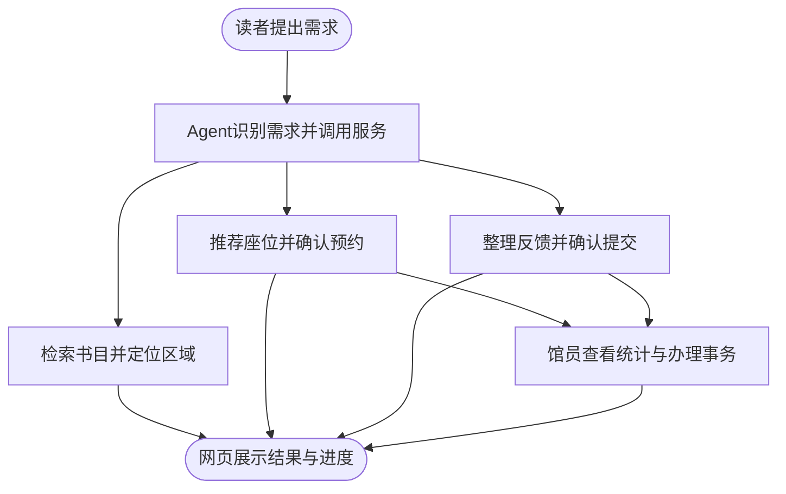

# AI图书馆服务与治理平台：项目需求草案 v0.1

_2026年10月29日｜依据本次讨论整理｜三个功能模块已确定，名称、数据规模和实施细节仍为建议；已完成读者网页、馆员演示工作台与Agent后端接口原型，尚未接入校方系统。_

本文保留立项时的需求和设计记录。当前实现与维护入口见 [项目首页](../../README.md)，同期技术方案见 [Agent 实现与数据接入方案](Agent实现与数据接入方案.md)。

## 📋 项目定位

围绕图书馆内的找书、找座和事务反馈三个场景，建设一个面向读者与馆员的网页平台，通过统一的自然语言交互入口调用相应服务。读者可以获取推荐、查看位置、完成预约和跟踪反馈；馆员可以处理问题，查看座位使用和事务办理情况。

三个模块均纳入首版范围。通过限制演示数据规模、覆盖楼层和问题类型控制工作量，各模块都需完成从提出需求到获得结果的完整流程。

项目的拟议特点是：将图书资源、空间资源和事务处理连接起来，使读者的需求能够转化为可查询、可执行、可追踪的操作。实际使用效率与体验改善有待原型试用验证。

## 🔍 现状依据与待验证问题

| 场景 | 已核实的公开信息 | 本项目拟验证或改进之处 |
|---|---|---|
| 找书 | 江大图书馆首页的馆藏查询入口提供题名、作者、ISBN/ISSN、分类号等检索字段；独立馆藏系统依赖脚本，本次未核实其全部能力[^1] | 能否根据学习目的、主题和阅读基础理解需求，减少读者自行组织检索词的负担 |
| 馆内导引 | 官方馆藏布局列明分类范围、楼层与区域，例如社会科学图书阅览室A区位于3楼北[^2] | 从查询结果衔接到楼层、区域与索书号指引；精确到书架须补充书架映射数据 |
| 座位服务 | 官方已提供选座、签到、暂离、退座及占座监督等服务说明[^3] | 在既有业务规则基础上，增加自然语言需求理解、条件匹配、推荐解释和统一展示 |
| 事务反馈 | 官网已有“你问我答”栏目，本次可见内容主要为带回复状态的既有问答；未核实其当前受理和流转能力[^4] | 验证馆内反馈是否存在入口不便、信息缺失、进度难查等问题，设计位置关联、分类流转与进度查询 |

用户在讨论中提出：现有布局介绍较粗、关键词检索不够方便，馆内事务沟通较多依赖QQ群。这些可作为需求访谈的线索，尚不据此认定学校只有上述服务渠道。正式申报宜表述为“拟改善自然语言检索、馆内定位与事务处理的连贯体验”，并补充读者和馆员的实际反馈。

## 📚 功能一：AI找书与馆内导引

读者可以描述主题、用途、知识基础和阅读偏好。系统在必要时追问，然后检索已有书目，返回候选图书及推荐依据。

首版拟实现：

- 自然语言检索：支持“不知道具体书名，但知道想了解什么”的表达，同时保留书名、作者等直接检索方式。
- 结果展示：提供书名、作者、主题、适合程度、推荐理由；仅在有相应数据时展示索书号、馆藏地和可借状态。
- 馆内导引：联动楼层示意图，高亮已知区域，并给出到达说明；有经过核实的书架映射后再提供书架定位。
- 结果核查：说明书目信息来源；没有匹配数据时说明缺项，提供修改需求或跳转官方检索的入口。

示例流程：读者输入“我想了解人工智能对教育的影响，适合本科生入门”→系统澄清阅读目的→查询书目→展示候选书及理由→打开对应楼层和区域。

书名、作者、馆藏位置和借阅状态均来自数据查询。模型负责理解和解释，不能补写未查到的馆藏记录。仅凭分类号和楼层布局，不能认定一本书所在的具体书架。

## 📊 功能二：AI智能座位服务与管理

读者表达位置、插座、环境偏好和使用时段，系统将需求转为筛选条件，调用座位数据推荐候选位置。网页同步显示楼层座位图和预约记录。

| 子功能 | 首版拟实现行为 | 必要边界 |
|---|---|---|
| 自然语言选座 | 提取日期、时段、插座、位置等条件；缺少必要信息时追问 | 安静程度须有采集或标注依据，区域标签不能描述成实时噪声监测 |
| 推荐与预约 | 给出候选座位和匹配理由，由读者确认后预约 | 没有完全匹配时明确说明放宽了哪些偏好；不能擅自放宽必要条件 |
| 座位状态管理 | 展示空闲、已预约、使用中；支持签到、取消、退座和超时释放 | 时间规则、冲突检查和状态变化由业务服务执行，操作结果以实际记录为准 |
| 管理端可视化 | 展示座位图、使用率、预约情况和热门时段 | 预约率与实际使用率分开计算；演示数据形成的统计须标注为演示统计 |

示例流程：读者输入“明天下午两点到五点，想找有插座、相对安静的位置”→系统查询可用座位→解释推荐→读者确认→重新检查时段冲突并预约→返回预约记录→签到后更新为使用中→退座或到期后释放。

未来时段的预约与当前座位占用状态分别记录。未签到超时、使用结束、取消和退座均应释放对应时段；发生预约冲突时保留实际成功的记录，并向另一位读者提供其他选择。原型规则与校方实际规则需要分别标识，不能把自拟规则表述为学校规定。

## 📋 功能三：馆员事务助手

将读者的自然语言反馈整理为可处理的问题记录。AI辅助识别类型、提取位置和补全信息，馆员负责确认受理、处理和回复。

首版拟覆盖设备故障、环境问题、秩序反馈、图书问题、服务建议和其他六类，分类可根据馆员反馈调整。

- 读者提交：用文字描述问题，可补充楼层、座位或书架等位置；图片附件作为可选材料。
- 信息整理：提取问题类型、位置、时间和内容摘要，提示补齐影响受理的信息，生成可编辑的提交预览。
- 确认提交：读者确认后创建记录，返回问题编号与初始状态。原型回执明确表示记录已进入原型系统。
- 馆员处理：查看问题列表，修正分类，分派处理人员，更新状态并回复。
- 进度查询：读者通过问题编号或个人记录查看“待受理—处理中—已回复/待确认—已办结”的变化，可补充信息或提出重新处理。

示例流程：“3楼北侧这个座位的插座没有电”→系统关联楼层和座位，追问缺失信息→读者确认提交→馆员处理→回复结果→读者查看并确认。

问题是否受理、是否属实以及是否完成，由相应人员和记录确定。设备或座位的停用由管理员确认后更新；反馈中的描述不会直接触发违规判定或处罚。

## 🔗 三个模块如何协同

模块之间共享经过核实的位置标识。例如，读者查到一本书后，可以在目标阅览区域附近查询座位；到达后发现设备问题，可以携带该座位的位置发起反馈；管理员确认设备不可用后，可以把相应座位设为不可预约。

网页同时保留找书、选座、反馈和个人记录的直接入口。对话适合表达复杂需求，图形与表单适合查看结果、核对条件和确认操作。首版可由一个Agent调用三类业务工具完成，暂不需要设计多个独立Agent。

## 🎯 首版范围与完成标准

以下规模用于估算工作量，可随数据获取情况调整，未表示相关资料已收集。

| 模块 | 建议演示规模 | 可验收的结果 |
|---|---|---|
| 找书导引 | 约30—50条来源清楚、主题有差异的书目；至少一个经过核实的区域 | 能按意图返回已有书目，显示理由与位置；无结果时明确反馈 |
| 座位服务 | 一个楼层或区域，约60个带位置与设施标签的演示座位 | 推荐、确认预约、状态查询、签到、取消、退座、超时释放和冲突处理均可操作 |
| 事务助手 | 六类问题、少量示例记录和馆员演示账号 | 读者确认提交后生成编号，馆员能更新状态，读者能查到处理结果 |
| 管理端 | 基于原型操作记录形成的统计 | 能区分预约与使用，显示明确统计时段，并跟随操作更新 |

数据与能力分为三个层次：

1. **公开或经核实的信息**：书目元数据、官方服务规则、馆藏区域；记录来源与核实时间。
2. **原型内运行的服务**：预约、签到、问题流转等操作实际写入原型记录，形成可回看、可验证的结果。
3. **后续校方对接能力**：统一身份认证、真实借阅状态、实时座位和官方事务流转。尚未接入时，界面与演示材料明确标注。

“模型已理解需求”“服务已执行成功”“官方系统已接收”需要分别判断和展示。模型服务不可用时，仍可直接使用检索、选座和反馈表单；演示模式应说明当前使用的是示例数据或规则匹配。

找书效果拟通过同一组真实任务比较关键词检索与自然语言检索；选座拟检查条件满足、冲突和状态变化；事务助手拟检查分类、信息完整度与进度追踪。此时先记录完成情况和失败案例，取得试用数据后再表述效率提升。

## 📝 可供报名表修改的作品简介

本项目拟面向高校图书馆中找书、选座与事务反馈的实际需求，建设集AI找书与馆内导引、智能座位服务、馆员事务助手于一体的网页平台。系统通过Agent理解读者的自然语言需求，调用书目、空间与事务服务，提供主题检索、图书推荐、位置指引、座位推荐与预约、使用状态查询及问题提交和进度追踪。馆员可通过管理端处理反馈，查看座位利用情况。项目拟以统一入口连接资源获取、空间使用与事务处理，探索AI支持校园服务与治理的可行路径。首版采用来源清楚的书目和规则，配合明确标注的演示数据完成流程验证；真实业务对接及应用效果有待后续试用与评估。

---

[^1]: 江苏大学图书馆。[官网首页：馆藏检索入口](https://lib.ujs.edu.cn/)。2026年10月29日核实可见检索字段，未完成独立馆藏系统及小程序全功能测试。
[^2]: 江苏大学图书馆。[馆藏布局](https://lib.ujs.edu.cn/gk1/gzbj.htm)。2026年10月29日读取，页面标题为“馆藏布局2026”。
[^3]: 江苏大学图书馆。[座位预约](https://lib.ujs.edu.cn/fw/zwyy.htm)。2026年10月29日读取；本次核实服务说明，未登录实际预约系统。
[^4]: 江苏大学图书馆。[你问我答](https://lib.ujs.edu.cn/lyb.jsp?urltype=tree.TreeTempUrl&wbtreeid=1063)。2026年10月29日读取公开列表，未提交信息或验证当前办理流程。
